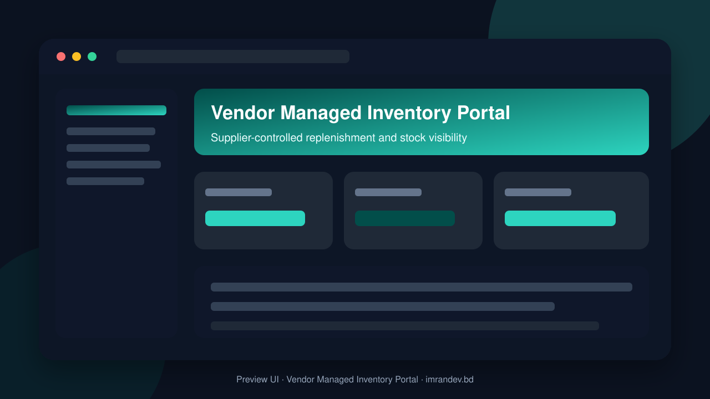
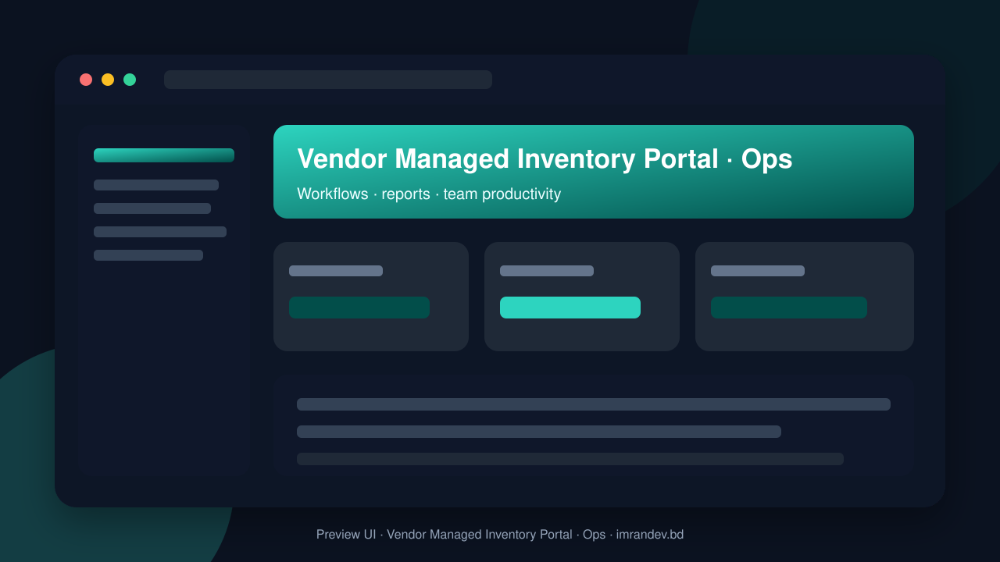

<p align="center">
  
</p>

# Vendor Managed Inventory Portal

<p align="center"><strong>Supplier-controlled replenishment and stock visibility</strong></p>

<p align="center">
  <a href="https://github.com/imranbru99/vendor-managed-inventory-vmi-portal"></a>
  
  
</p>

---

## Overview

**Vendor Managed Inventory Portal** — Supplier-controlled replenishment and stock visibility.

This README documents the **real application features** so GitHub and Google visitors can understand what the product does.

## Product screenshots

| Dashboard | Operations |
| :---: | :---: |
|  |  |

## Application features

### Vendor-managed inventory (VMI)

- Shared stock visibility between buyer and supplier
- Min/max and reorder point rules
- Supplier-controlled replenishment proposals
- Auto-replenishment suggestions and approvals
- Shipments, ASN and receiving against VMI
- Consumption / sell-through analytics
- Multi-warehouse location support
- Audit trail of supplier inventory actions

### Detailed modules from product specification

- **Performance optimization**
- **Admin dashboard**
- **AI catalog**
- **AI provider integration**
- **Attendance machine integration**
- **Multilingual PDF**
#### Multilingual slug

- APPLICATION ARCHITECTURE
- MULTI-TENANT SYSTEM
- COMPLETE MODULAR SYSTEM
- CORE BUSINESS MODULES

- **Organization Management**
- **Supplier Management**
- **Product Catalog Management**
- **Inventory Management**
- **Vendor Managed Inventory Configuration**
- **Replenishment Engine**
- **Replenishment Proposal Management**
- **Purchase Order Management**
- **Supplier Order Fulfillment**
- **Warehouse Management**
- **Receiving and Goods Receipt**
- **Logistics and Shipment Tracking**
- **Consignment Inventory**
- **Quality Control**
- **Batch, Lot and Expiry Management**
- **Returns Management**
#### Finance and Reconciliation

- APPROVAL AND WORKFLOW ENGINE
- AI-POWERED BUSINESS INTELLIGENCE
- INTEGRATION CENTER
- REPORTING AND ANALYTICS
- DASHBOARDS
- NOTIFICATION SYSTEM
- PUBLIC WEBSITE AND MARKETING PAGES
- UI/UX DESIGN REQUIREMENTS
- DATABASE DESIGN
- SECURITY AND ENTERPRISE REQUIREMENTS
- MULTILINGUAL AND MULTICURRENCY SUPPORT
- DEMO ENVIRONMENT
- README.MD DOCUMENTATION
- TESTING AND QUALITY ASSURANCE
- PERFORMANCE AND SCALABILITY
- AUTOMATED BUSINESS OPERATIONS
- SUBSCRIPTION AND SAAS BUSINESS MODEL
- ADDITIONAL ENTERPRISE FEATURES
- REQUIRED END-TO-END BUSINESS SCENARIO
- DEVELOPMENT EXECUTION PLAN
- FINAL ACCEPTANCE CRITERIA

### Admin screens (Filament resources)

- Audit Log management
- Blog Post management
- Buyer Supplier Relationship management
- Cms Page management
- Goods Receipt management
- Integration management
- Inventory Balance management
- Module management
- Organization management
- Product management
- Purchase Order management
- Replenishment Proposal management
- Replenishment Recommendation management
- Shipment management
- Tenant management
- User management
- Vmi Agreement management
- Vmi Policy management
- Warehouse management

### Domain data models

- Advance Shipping Notice
- Audit Log
- Blog Post
- Buyer Supplier Relationship
- Cms Page
- Consignment Agreement
- Consignment Balance
- Consignment Movement
- Contact Message
- Demand Event
- Demo Request
- Document
- Faq
- Goods Receipt
- Goods Receipt Line
- Integration
- Inventory Balance
- Inventory Transaction
- Module
- Notification Preference
- Organization
- Organization Membership
- Payment Record
- Product
- Product Category
- Purchase Order
- Purchase Order Approval
- Purchase Order Line
- Quality Inspection
- Replenishment Proposal
- Replenishment Proposal Line
- Replenishment Recommendation
- Replenishment Run
- Return Line
- Return Request
- Scheduled Task Run
- Shipment
- Shipment Line
- Shipment Tracking Event
- Subscription Plan
- Supplier Acknowledgment
- Supplier Invoice
- Supplier Invoice Line
- Supplier Product
- Tenant
- Tenant Module
- Tenant Setting
- Tenant Subscription
- Unit Of Measure
- Vmi Agreement
- Vmi Policy
- Warehouse
- Warehouse Location
- Webhook Delivery
- Webhook Endpoint

## Tech stack

- PHP 8.2+ / Laravel
- Filament admin (where enabled)
- Migrations, seeders, queues
- Vite asset pipeline
- MySQL / SQLite ready

## Quick start

```bash
git clone https://github.com/imranbru99/vendor-managed-inventory-vmi-portal.git
cd vendor-managed-inventory-vmi-portal
composer install
cp .env.example .env
php artisan key:generate
php artisan migrate --seed
npm install && npm run build
php artisan serve
```

## Author

**Imran Ahmed** · https://imrandev.bd · me@imrandev.bd  
GitHub: https://github.com/imranbru99/vendor-managed-inventory-vmi-portal

---
## 🤝 Let's Connect & Collaborate

I am open to **Senior Remote Full-Stack Roles**, AI Platform Architecture Contracts, and Enterprise Technical Advisory.

| Channel | Link |
| :--- | :--- |
| Portfolio | https://imrandev.bd |
| GitHub | https://github.com/imranbru99 |
| LinkedIn | https://linkedin.com/in/imranbru99 |
| Email | me@imrandev.bd |
| WhatsApp | https://wa.me/8801576918420 |
| Packagist | https://packagist.org/packages/imrandevbd/ |

